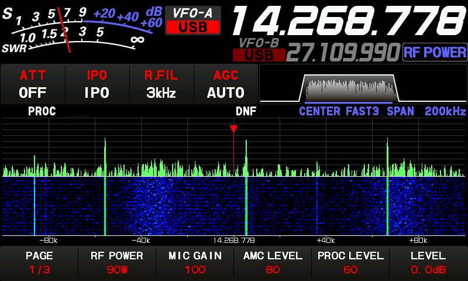
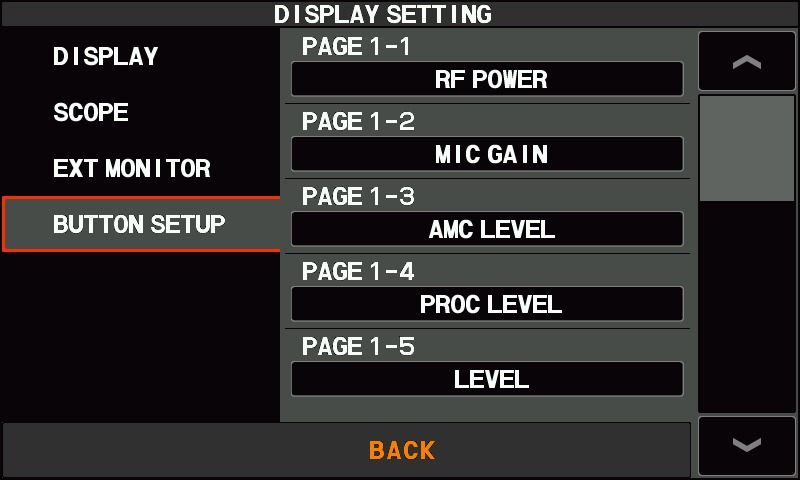

# FTdx10 custom buttons patch

**Online patcher:** [ftdx10-mod.sq9pd.pl](https://ftdx10-mod.sq9pd.pl)

[Polski](README.md)

## 1. Warnings and backup

Unofficial modification, not approved by Yaesu. You modify and install firmware at your own risk, with no warranty or manufacturer support. An error or interrupted update may cause loss of settings, malfunction or render the radio inoperable.

Before installing the modification, back up your radio settings and memories. Also keep the original, unmodified firmware files. Follow the Yaesu FTdx10 firmware update instructions when installing.

## 2. What the modification does

Three pages of 5 configurable buttons below the waterfall replace the spectrum/waterfall control buttons. Configure them in DISPLAY SETTING → BUTTON SETUP.

The fixed PAGE button switches pages. You can assign the following functions to the other five buttons on each page.

### Assignable functions

`LEVEL`, `PEAK`, `MARKER`, `COLOR`, `CONTRAST`, `DIMMER`, `M-GROUP`, `MIC GAIN`, `MIC EQ`, `PROC LEVEL`, `AMC LEVEL`, `VOX GAIN`, `VOX DELAY`, `ANTI VOX`, `RF POWER`, `MONI LEVEL`, `KEYER`, `BK-IN`, `CW SPEED`, `CW PITCH`, `BK-DELAY`, `DNF`, `MESSAGE`, `RECORD`, `PLAY`, `DECODE`, `D-MODE`, `3DSS`, `MULTI`, `EXPAND`, `SPAN`, `SPEED`.





## 3. Restoring original firmware

1. Back up the radio settings and memories you want to restore later.
2. Install the original, unmodified MAIN and DISPLAY firmware in the radio, following the Yaesu FTdx10 instructions.
3. After installing the original firmware, reset the radio to factory settings following the radio manual. The reset erases user settings.

Installing the original firmware does not replace the factory reset. This tool prepares files; it does not program or repair the radio.

## 4. Patch firmware files

Download the original FTdx10 firmware from the manufacturer’s Yaesu website: MAIN 01-15 and DISPLAY 01-06. This patch requires these exact versions and the hashes listed below. If the manufacturer provides a different version, do not use it with this patch.

Your files are never uploaded to a server. SHA-256 verification and patching run entirely on your computer, in your browser. No analytics or external libraries.

DISPLAY V06 + MAIN V05. Yaesu base: DISPLAY 01-06 / MAIN 01-15. V06 and V05 are modification versions; output SFL filenames retain the factory version numbers.

Choose MAIN and DISPLAY in separate fields. SHA-256 is checked immediately after selection. A mismatch blocks patching of that component. After patching, expected and actual output hashes are displayed; only a matching result can be downloaded.

### MAIN V05 — `FTDX10_MAIN_V0115.SFL`

| SHA-256 | Hash |
| --- | --- |
| Expected original SHA-256 | `6d04cc11a1f5531212be85da2238d47767920d6a3d11365907f58404466202eb` |
| Expected patched SHA-256 | `48bf9aee3ff5707f1fd370a2acf903bf2bb0ef40ea59623882dfdd2d1275facf` |

### DISPLAY V06 — `FTDX10_DISPLAY_V0106.SFL`

| SHA-256 | Hash |
| --- | --- |
| Expected original SHA-256 | `6692d93e285705bc4d4c32c6f0ab75104b0fa0cc91cde3f818696160f8c68222` |
| Expected patched SHA-256 | `507865715516e63487e7c887a70a0280c8c6c92a9a8c494fbb6caa187e32328c` |

## Python CLI

Python 3.9+, standard library only. Use a new output directory; existing files and directories are never overwritten.

```sh
python3 patch.py /path/FTDX10_MAIN_V0115.SFL /path/FTDX10_DISPLAY_V0106.SFL --out ./modified
```

## Local page and static hosting

Open `site/index.html` in a current browser. If Web Crypto is unavailable with `file://`, run:

```sh
python3 -m http.server 8000 --bind 127.0.0.1 --directory site
```

Open <http://localhost:8000>. For GitHub Pages or another static host, publish all files in `site/`, including `images/`, using HTTPS. No backend is required.

## Tool verification

Python and JavaScript reproduce both reference SFL files byte for byte. Tests reject modified, truncated and already patched inputs and incorrect output hashes. Historical files in `docs/` refer to the full source project.

---

SQ9PD :)
