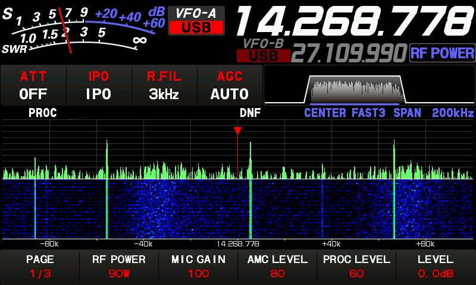
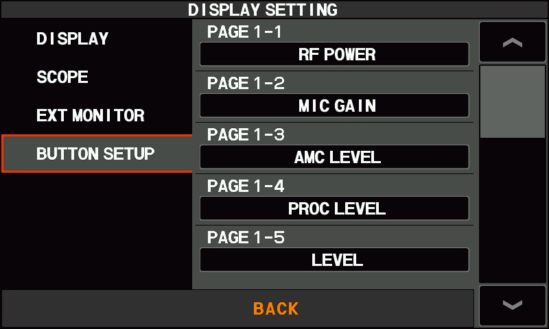

# FTdx10 custom buttons patch

**Patcher online:** [ftdx10-mod.sq9pd.pl](https://ftdx10-mod.sq9pd.pl)

[English](README.en.md)

## 1. Ostrzeżenia i kopia zapasowa

Nieoficjalna modyfikacja, niezatwierdzona przez Yaesu. Modyfikujesz i instalujesz firmware na własną odpowiedzialność, bez gwarancji działania ani wsparcia producenta. Błąd lub przerwanie aktualizacji może spowodować utratę ustawień, nieprawidłowe działanie albo unieruchomienie radia.

Przed wgraniem modyfikacji zrób kopię ustawień radia i pamięci. Zachowaj również oryginalne, niezmodyfikowane pliki firmware. Instalację wykonuj zgodnie z instrukcją aktualizacji Yaesu dla FTdx10.

## 2. Co zawiera modyfikacja

Trzy strony po 5 konfigurowalnych przycisków pod wodospadem zamiast przycisków obsługi spectrum/wodospadu. Konfiguracja odbywa się w menu DISPLAY SETTING → BUTTON SETUP.

Stały przycisk PAGE przełącza strony. Do pozostałych pięciu przycisków na każdej stronie można przypisać poniższe funkcje.

### Funkcje do przypisania

`LEVEL`, `PEAK`, `MARKER`, `COLOR`, `CONTRAST`, `DIMMER`, `M-GROUP`, `MIC GAIN`, `MIC EQ`, `PROC LEVEL`, `AMC LEVEL`, `VOX GAIN`, `VOX DELAY`, `ANTI VOX`, `RF POWER`, `MONI LEVEL`, `KEYER`, `BK-IN`, `CW SPEED`, `CW PITCH`, `BK-DELAY`, `DNF`, `MESSAGE`, `RECORD`, `PLAY`, `DECODE`, `D-MODE`, `3DSS`, `MULTI`, `EXPAND`, `SPAN`, `SPEED`.





## 3. Powrót do oryginalnego firmware

1. Zrób kopię ustawień radia i pamięci, które chcesz później odtworzyć.
2. Wgraj do radia oryginalne, niezmodyfikowane firmware MAIN i DISPLAY zgodnie z instrukcją Yaesu dla FTdx10.
3. Po wgraniu oryginałów wykonaj reset do ustawień fabrycznych zgodnie z instrukcją radia. Reset usuwa ustawienia użytkownika.

Samo wgranie oryginalnego firmware nie zastępuje resetu. Narzędzie przygotowuje pliki; nie programuje ani nie naprawia radia.

## 4. Patchowanie plików

Pobierz oryginalne firmware FTdx10 ze strony producenta Yaesu: MAIN 01-15 i DISPLAY 01-06. Patch wymaga dokładnie tych wersji i hashy podanych poniżej. Jeśli producent udostępnia inną wersję, nie używaj jej z tym patchem.

Pliki nie są wysyłane na serwer. Weryfikacja SHA-256 i nakładanie patcha odbywają się wyłącznie na Twoim komputerze, w przeglądarce. Bez analityki i zewnętrznych bibliotek.

DISPLAY V06 + MAIN V05. Baza Yaesu: DISPLAY 01-06 / MAIN 01-15. V06 i V05 to wersje modyfikacji; nazwy wynikowych SFL zachowują numery fabryczne.

Wybierz MAIN i DISPLAY w oddzielnych polach. SHA-256 jest sprawdzany od razu po wybraniu pliku. Niezgodność blokuje patchowanie tego komponentu. Po patchowaniu widoczne są oczekiwany i rzeczywisty hash wyniku; tylko zgodny wynik można pobrać.

### MAIN V05 — `FTDX10_MAIN_V0115.SFL`

| SHA-256 | Hash |
| --- | --- |
| Oczekiwany SHA-256 oryginału | `6d04cc11a1f5531212be85da2238d47767920d6a3d11365907f58404466202eb` |
| Oczekiwany SHA-256 po patchu | `48bf9aee3ff5707f1fd370a2acf903bf2bb0ef40ea59623882dfdd2d1275facf` |

### DISPLAY V06 — `FTDX10_DISPLAY_V0106.SFL`

| SHA-256 | Hash |
| --- | --- |
| Oczekiwany SHA-256 oryginału | `6692d93e285705bc4d4c32c6f0ab75104b0fa0cc91cde3f818696160f8c68222` |
| Oczekiwany SHA-256 po patchu | `507865715516e63487e7c887a70a0280c8c6c92a9a8c494fbb6caa187e32328c` |

## Skrypt Python

Wymagany Python 3.9 lub nowszy. Bez instalowania pakietów, kompilatora i dodatkowych bibliotek. Uruchom z katalogu tej paczki:

```sh
python3 patch.py /sciezka/FTDX10_DISPLAY_V0106.SFL /sciezka/FTDX10_MAIN_V0115.SFL --out ./modified
```

Na Windows użyj `py -3 patch.py ...`. Ścieżki zawierające spacje ujmij w cudzysłowy.

Katalog `modified` musi być nowy. Skrypt najpierw sprawdza wszystkie wybrane wejścia, następnie tworzy wyniki i `verification.json`. Nie nadpisuje wejściowych SFL ani istniejącego katalogu. Można podać tylko jeden komponent; do docelowego kompletu używaj DISPLAY V06 i MAIN V05. Jeśli masz już zweryfikowany MAIN V05, nie trzeba generować go ponownie.

## Strona lokalna

Otwórz `site/index.html` w aktualnej przeglądarce. Wybierz oryginalne pliki, przeczytaj ostrzeżenia, zaznacz zgodę i kliknij „Zweryfikuj i przygotuj pliki”. Każdy wynik ma osobny przycisk pobrania. Zachowaj oryginały; pobieraj wyniki do innego katalogu.

Web Crypto wymaga bezpiecznego kontekstu. Jeśli przeglądarka nie udostępnia go dla `file://`, uruchom lokalny serwer:

```sh
python3 -m http.server 8000 --bind 127.0.0.1 --directory site
```

Otwórz <http://localhost:8000>. Serwer dostarcza jedynie statyczne HTML/CSS/JS. Przeglądarka czyta wybrane SFL lokalnie i lokalnie tworzy wynik; skrypty nie wykonują żadnych żądań sieciowych. Polityka CSP dodatkowo blokuje połączenia (`connect-src 'none'`). Nie ma analityki, CDN, formularza uploadu ani zależności zewnętrznych.

## GitHub Pages / inny hosting statyczny

Opublikuj zawartość `site/` jako katalog główny witryny, zachowując wszystkie pliki oraz katalog `images/`. Możesz skopiować je do `docs/` repozytorium przeznaczonego na GitHub Pages lub wdrażać `site/` własnym workflow. Wymagany HTTPS; backend nie jest potrzebny. Paczka nie zawiera konfiguracji przypisanej do konkretnego konta ani repozytorium.

## Jak działa patch

1. Rozpoznaje oryginał po SHA-256 całego SFL i sprawdza rozmiar, nagłówek oraz CRC kontenera.
2. Rozpakowuje/odkodowuje payload SFL (przesunięcie bajtów kluczem Yaesu; nie ZIP). MAIN zawiera tekst Motorola S-record, DISPLAY tekst ASCII hex.
3. Sprawdza hash odkodowanego wejścia. Nakłada zapisane różnice, sprawdzając stare bajty każdego zakresu. Zmiany MAIN obejmują również wynikowe sumy rekordów S-record, odtworzone z wydanego pliku.
4. Sprawdza hash zmienionego payloadu, pakuje/koduje SFL i odtwarza nagłówek wydania.
5. Sprawdza CRC oraz znany SHA-256 całego wyniku. Niezgodny wynik nie jest udostępniany do pobrania ani zapisywany przez CLI.

Jest to deterministyczny patch dokładnej pary wydań, a nie kompilator kodu firmware ani uniwersalne narzędzie edycji SFL. Nagłówek i sumy pochodzą z zatwierdzonego pliku referencyjnego, nie z dowolnego nowego kodu. Wszystkie dane różnicowe znajdują się w `site/patch-data.js`; Python i JS korzystają z tego samego zestawu.


## Weryfikacja narzędzia

Python i JavaScript odtwarzają oba SFL bajt w bajt zgodnie z wydanymi paczkami. Testy obejmują odrzucanie zmienionych, uciętych i już zmodyfikowanych wejść oraz niezgodnych hashy wyniku. Historyczne opisy w `docs/` odnoszą się do pełnego projektu źródłowego.

---

SQ9PD :)
